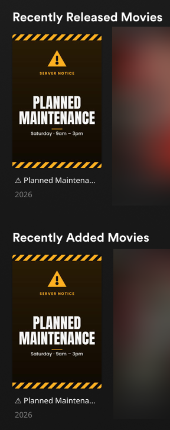
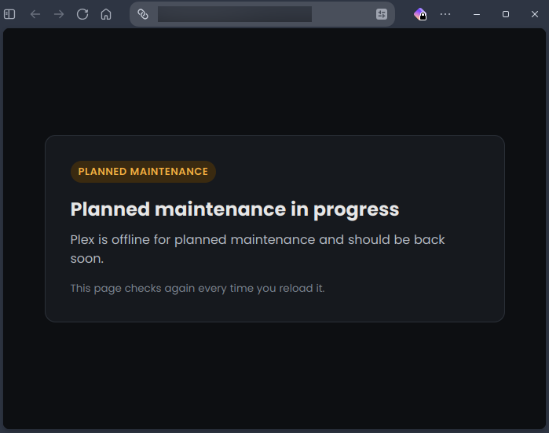
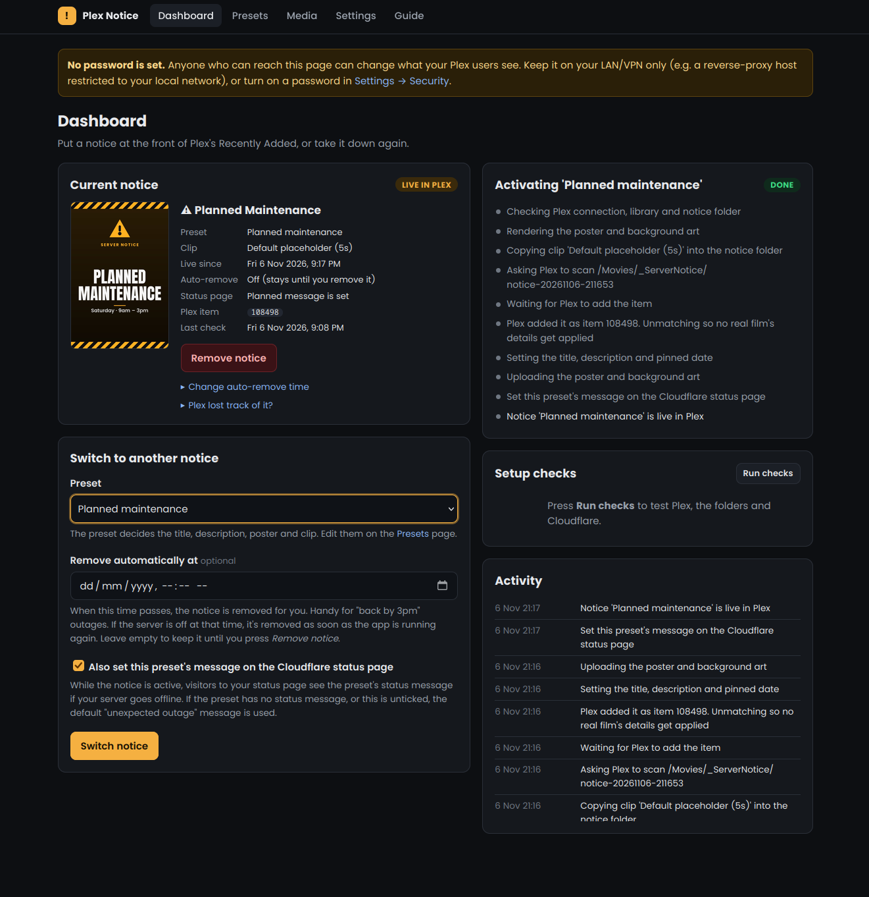
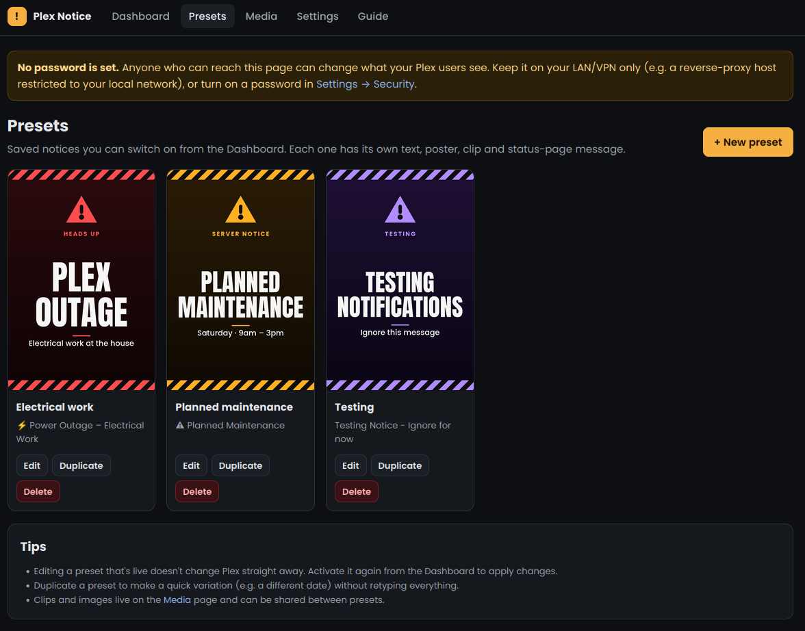
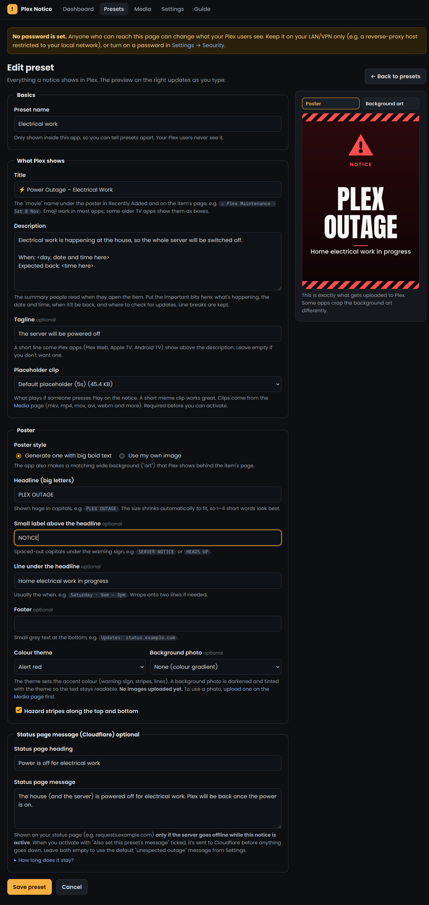
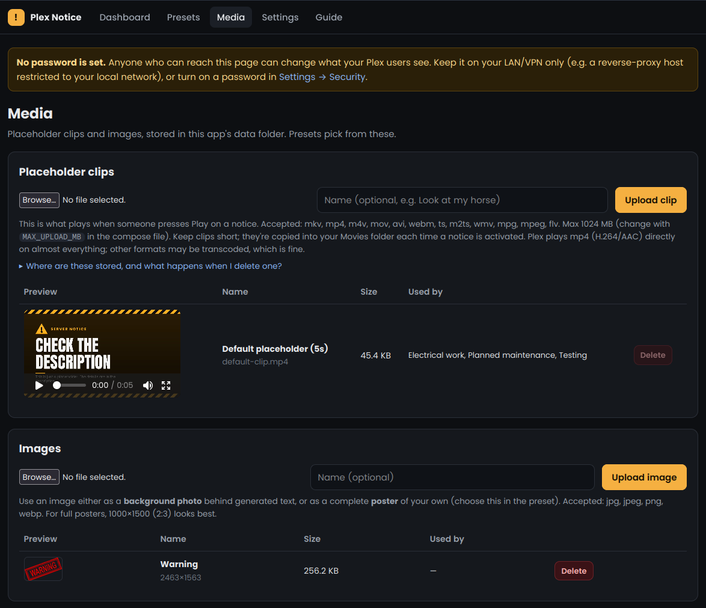
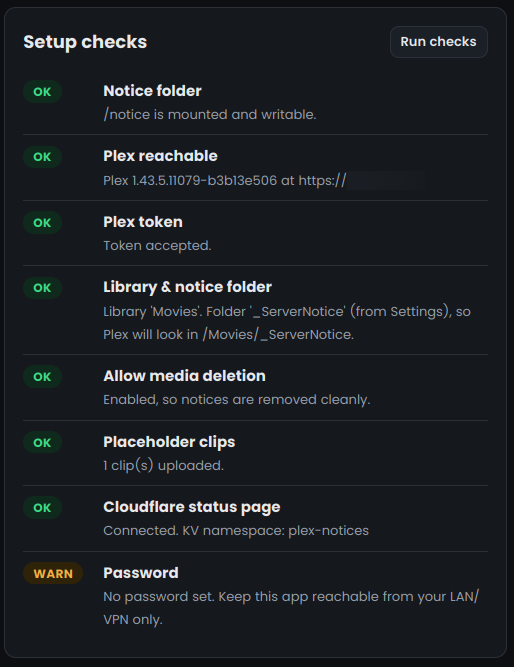
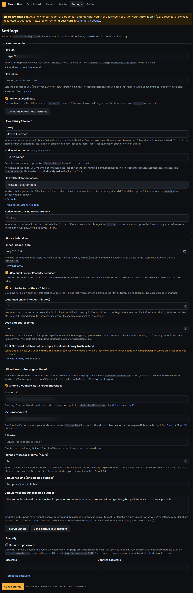
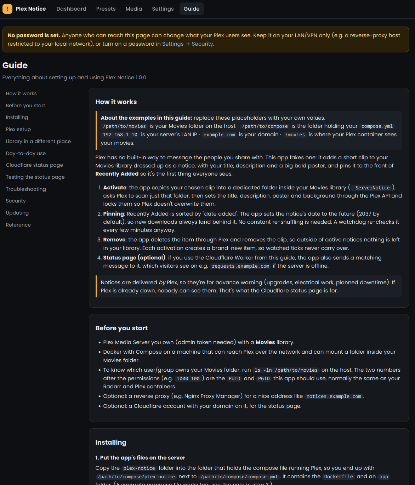

# Plex Notice

**Post maintenance notices straight into your Plex users' Home screen.**

Plex has no way to message the people you share your server with. Plex Notice fakes one: it adds a short placeholder
clip to your Movies library, dressed up as a notice with your own title, description and a big bold poster, and pins
it to the front of **Recently Added** and **Recently Released**. Everyone sees it the next time they open Plex. Switch
it off and it's gone without a trace.

It also pairs with an optional **Cloudflare Worker status page**, so if your server is offline, visitors to a site
like `requests.example.com` see a proper maintenance message instead of a browser error.

> [!IMPORTANT]
> ## 🤖 Built with AI
> **This project was written with [Claude Opus 5.5](https://www.anthropic.com/claude), Anthropic's AI model.**
> The code, the in-app guide, the Cloudflare Worker and this README were written by Claude, working with zuusuuz, who came up
> with the idea, made the design decisions, and tested every feature on a real Plex server.
> It works well in that setup, but as with any project, read the code and test it on your own server before relying on it.

<p align="center">
  
  &nbsp;&nbsp;
  
</p>

> Built for advance warnings: server upgrades, planned downtime, electrical work at the house. Notices are delivered
> *by* Plex, so they can't announce an outage after Plex is already down. That's what the status page is for.

---

## Contents

- [Features](#features)
- [How it works](#how-it-works)
- [Screenshots](#screenshots)
- [Requirements](#requirements)
- [Installation](#installation)
- [First-time setup](#first-time-setup)
- [Everyday use](#everyday-use)
- [Cloudflare status page (optional)](#cloudflare-status-page-optional)
- [Configuration reference](#configuration-reference)
- [Updating](#updating)
- [Troubleshooting](#troubleshooting)
- [Safety and security](#safety-and-security)
- [FAQ](#faq)
- [Project layout](#project-layout)
- [Credits and licence](#credits-and-licence)

---

## Features

- **Web UI for phone, tablet and desktop.** Dark theme, every option explained beside it, plus a built-in Guide.
- **Presets.** Save as many notices as you like (planned maintenance, server upgrade, power outage…) and switch
  between them in one click. Only one is live at a time.
- **Generated posters.** A big bold headline, a small label, a subline and a footer, with six colour themes, optional
  hazard stripes and an optional background photo. Or upload your own finished poster. A matching 16:9 background is
  made automatically. A live preview shows exactly what Plex will get.
- **Your own placeholder clips.** Upload whatever should play if someone presses Play (mkv, mp4, mov, avi, webm and
  more). A 5-second default clip is included.
- **Pinned to the front.** A future "date added" keeps the notice first in *Recently Added*, and a matching release date
  keeps it first in *Recently Released*. New downloads land behind it. Optionally first in A–Z too.
- **Auto-remove** at a time you choose (e.g. "back by 3pm"). If the server was off at that moment, it's removed as soon
  as the app is running again.
- **Watchdog** re-checks the live notice every few minutes and puts its date and title back if anything changed them.
- **Clean removal** through Plex's own delete. Your library's trash is never emptied unless you explicitly opt in.
- **Setup checks** test Plex, the token, the library, the folder mapping, media deletion and Cloudflare in one click.
- **Cloudflare status page integration.** Each preset can carry its own "planned outage" message for the status page,
  with a separate default for surprises. Messages expire automatically.
- **Movies and Other Videos libraries** are supported.
- **Optional password**, and LinuxServer-style `PUID`/`PGID` handling, so folder permissions just work.

---

## How it works

```
 You (web UI) ──► Plex Notice ──► copies clip into  <Movies>/_ServerNotice/notice-YYYYMMDD-HHMMSS/
                        │
                        ├──► Plex API: scan just that folder, set title / description / poster / background,
                        │    set "date added" + release date to 2037, lock the fields
                        │
                        └──► Cloudflare KV (optional): store this preset's status-page message
```

1. **Activate.** The app copies your clip into a dedicated folder inside your library and asks Plex to scan only that
   folder. It unmatches the item (so Plex doesn't swap in a real film's details), then sets the title, description,
   poster and background art and locks them.
2. **Pin.** *Recently Added* is sorted by date added and *Recently Released* by release date. The notice gets a date in
   2037 for both, so it stays first. Dates after January 2038 are avoided on purpose: some clients still use 32-bit
   timestamps and would wrap them round to the bottom.
3. **Remove.** The app deletes the item through Plex and removes the clip. Each activation creates a brand-new item, so
   watched ticks never carry over to the next notice.
4. **Status page (optional).** A Cloudflare Worker sits in front of a website you already expose (e.g. Seerr). Visitors
   pass straight through, but if your server can't be reached, the Worker shows a maintenance page using the message
   this app stored in Workers KV.

---

## Screenshots

**Dashboard**: what's live, activate/switch notices, auto-remove, progress of each step, and the activity log.



**Presets**: saved notices with their generated posters.



<details>
<summary><strong>More screenshots</strong> (preset editor, media, settings, setup checks, guide)</summary>

**Preset editor**, with live poster preview



**Media**: placeholder clips and images



**Setup checks**



**Settings**, with every option documented in place



**Built-in guide**



</details>

---

## Requirements

- A Plex Media Server you own (you need its admin token) with a **Movies** or **Other Videos** library.
- Docker with Compose, on a machine that can reach Plex and can mount a folder inside that library.
- Optional: a reverse proxy (e.g. Nginx Proxy Manager) for a nice local address like `notices.example.com`.
- Optional: a Cloudflare account with your domain on it (free plan is fine) for the status page.

---

## Installation

The examples use placeholders. Replace them with your own values:

| Placeholder | Means |
|---|---|
| `/path/to/movies` | Your Movies folder on the host |
| `/path/to/compose` | The folder holding the `compose.yml` that runs Plex |
| `192.168.1.10` | Your server's LAN IP |
| `example.com` | Your domain |

### 1. Get the code

Put this project in a folder called `plex-notice` inside `/path/to/compose`:

```bash
cd /path/to/compose
git clone https://github.com/zuusuuz/plex-notice.git
```

(Or download the ZIP from GitHub and unpack it there.)

### 2. Add the service to your compose file

Add this under `services:` in the `compose.yml` that runs Plex (also in [`compose.example.yml`](compose.example.yml)):

```yaml
  plex-notice:
    build: ./plex-notice
    image: plex-notice:local
    container_name: plex-notice
    environment:
      - PUID=1000                 # user ID that owns your movies folder   (ls -ln /path/to/movies)
      - PGID=1000                 # group ID that owns your movies folder
      - TZ=Etc/UTC                # your time zone, e.g. Europe/London, Australia/Brisbane
      # - MAX_UPLOAD_MB=1024      # biggest clip/image upload allowed
      # - DISABLE_AUTH=true       # only to recover a forgotten password
    volumes:
      - ./plex-notice-data:/data                   # settings, presets, clips, images
      - /path/to/movies/_ServerNotice:/notice      # a folder DIRECTLY inside your library
    ports:
      - "8742:8742"
    restart: unless-stopped
```

Only change the left-hand side of each volume. Don't add a `user:` line: `PUID`/`PGID` replace it. Missing folders
are created by Docker and handed to `PUID`:`PGID` automatically, the same way LinuxServer images do it.

### 3. Build and start

```bash
cd /path/to/compose
docker compose up -d --build plex-notice
docker compose logs plex-notice | head     # look for: [init] User UID: 1000  User GID: 1000
```

Open `http://192.168.1.10:8742`.

---

## First-time setup

1. **Plex: allow media deletion.** Plex Web → **Settings** → *your server* → **Library** → tick **Allow media
   deletion** → **Save Changes**. This lets the app remove notices cleanly.
2. **Plex connection.** In the app: **Settings → Plex connection**. Enter the Plex URL (`http://192.168.1.10:32400`)
   and your token, then press **Test connection & load libraries**. To find the token: open any movie in Plex Web →
   **⋮ → Get Info → View XML**, and copy everything after `X-Plex-Token=` in the new tab's address bar.
3. **Library.** Pick your library under **Plex library & folders**. *Plex will look for notices in* shows the path the
   app worked out: the library's folder as Plex sees it, plus the notice folder's name (detected from your compose
   file). With a standard setup there's nothing else to enter.
4. **Check.** **Save settings**, then **Dashboard → Run checks**. Green is good, amber is a warning, red needs fixing.
5. **Optional.** Turn on a password (**Settings → Security**) and/or put the app behind your reverse proxy on a
   LAN-only access list.

Your library is somewhere unusual (Unraid, Synology, Plex not in Docker, Plex on another machine)? See
**Guide → Library in a different place** inside the app.

---

## Everyday use

1. **Media.** Upload a placeholder clip or two (a meme clip works great) and any images you want for posters.
2. **Presets.** Create a preset: title, description, tagline, clip, poster design and (optionally) the status-page
   message. Duplicate presets to make variations quickly.
3. **Activate.** Dashboard → pick the preset → optionally set **Remove automatically at** → **Activate**. It takes
   10–30 seconds. TV apps may cache their Home screen for a few minutes.
4. **Remove.** Press **Remove notice**, or let the auto-remove time do it.

Tip: activate a notice a day or two before planned work so people see it, and set auto-remove for when the work should
be finished.

---

## Cloudflare status page (optional)

A small Cloudflare Worker sits in front of a site you already expose through Cloudflare (for example
`requests.example.com` running Seerr). Normally it passes every request straight to your server. When your server
can't be reached, whether the container is stopped, the host is down or the whole house is off, it shows a maintenance
page instead:

- **Planned:** while a notice is active, the preset's own message (amber *Planned maintenance* tag, optional
  "Expected back" time).
- **Unexpected:** your default message from Settings (red *Server offline* tag).

Everything fits in Cloudflare's free plan. The Worker only reads KV while your server is down.

**Setup in short** (the in-app **Guide → Cloudflare status page** has every click):

1. Create a Workers KV namespace (e.g. `plex-notices`).
2. Create an API token with only **Account → Workers KV Storage → Edit**.
3. Create a Worker from [`app/worker/requests-fallback.js`](app/worker/requests-fallback.js) and bind the KV
   namespace to it as `NOTICES`.
4. Set SSL/TLS to **Full (strict)**, make the site's DNS record **Proxied**, and add a **Workers Route**
   `requests.example.com/*` → the Worker (failure mode: *Fail open*).
5. In the app: **Settings → Cloudflare status page**. Enter the Account ID, namespace ID and token, then press
   **Test Cloudflare** and **Save settings**.

**Troubleshooting addresses** (they work even while your server is up, through Cloudflare):

- `https://requests.example.com/__plex-notice/status` shows what the Worker sees: the KV binding, the stored messages,
  and which one it would show.
- `https://requests.example.com/__plex-notice/preview` shows the maintenance page as visitors would see it right now.

**At home:** if your local DNS points the site straight at your reverse proxy, home devices never touch Cloudflare
and get a plain "502 Bad Gateway". With AdGuard Home `$dnsrewrite` rules, exempt just that name by adding this to
**Filters → Custom filtering rules**:

```
@@||requests.example.com^$dnsrewrite
```

---

## Configuration reference

### Environment variables

| Variable | Default | Purpose |
|---|---|---|
| `PUID` / `PGID` | `1000` / `1000` | User and group the app runs as. Match the owner of your movies folder. |
| `TZ` | `UTC` | Time zone for auto-remove times and displayed dates. |
| `MAX_UPLOAD_MB` | `1024` | Largest clip or image you can upload. |
| `DISABLE_AUTH` | off | `true` bypasses the password (recovery only). |
| `PORT` | `8742` | Port inside the container. |

### Volumes

| In container | Example on host | Purpose |
|---|---|---|
| `/data` | `./plex-notice-data` | Settings, presets, uploaded media, logs. **Back this up.** |
| `/notice` | `/path/to/movies/_ServerNotice` | Holds the clip while a notice is live (plus a hidden keep-file). |

### Main settings (in the web UI)

| Setting | What it does |
|---|---|
| Plex URL / token | How the app reaches Plex. LAN IP recommended; a container name works on a shared Docker network. |
| Library | The Movies or Other Videos library the notice appears in. |
| Notice folder name | Usually blank (detected automatically). The folder mounted at `/notice`. |
| Advanced: custom Plex path | Only if the notice folder isn't directly inside a library folder. |
| Pinned "added" date | The future date used for pinning (default 2037-01-01; must be 2037 or earlier). |
| Also first in "Recently Released" | Gives the notice the same future release date. |
| Sort to the top of A–Z | Adds a hidden `!` sort title. |
| Watchdog interval | How often the live notice is re-checked (minutes, `0` = off). |
| Scan timeout | How long to wait for Plex to pick up the clip. |
| Empty-trash fallback | Off by default. Risky with pooled/removable disks; see the in-app note. |
| Cloudflare | Account ID, KV namespace ID, API token, message lifetime, default message. |
| Security | Optional password. |

---

## Updating

```bash
cd /path/to/compose/plex-notice
git pull
cd ..
docker compose up -d --build plex-notice
```

Your settings, presets and media live in `plex-notice-data` and aren't touched.

---

## Troubleshooting

| Problem | Fix |
|---|---|
| "Plex didn't add the clip within …s" | The folder mounted at `/notice` isn't where Plex is looking. Compare your compose line with **Settings → Plex will look for notices in**. |
| `Permission denied: '/data/…'` | Remove any `user:` line from compose and set `PUID`/`PGID`, then recreate the container. |
| "The notice folder /notice is gone inside the container" | The folder was deleted on the host while the app was running. Run `docker compose up -d --force-recreate plex-notice`. Leave the hidden `.plex-notice-keep` file in it. |
| "Unavailable" leftover in the library | Turn on *Allow media deletion* in Plex, then **Dashboard → Retry cleanup**. |
| Notice not first on a TV | TV apps cache Home. Back out to Home or restart the app. |
| Status page shows the wrong text | Open `/__plex-notice/status` on your site from mobile data. |
| Upload fails with 413 | Raise your reverse proxy's upload limit (NPM: host → Advanced → `client_max_body_size 1024m;`). |

The Dashboard's progress list, the Activity log and `docker compose logs plex-notice` show every step.

---

## Safety and security

- The container only gets the **one** notice folder from your library, so it physically can't write anywhere else.
  It only ever deletes folders it created itself (`notice-YYYYMMDD-HHMMSS`).
- At startup it changes the owner of only its data folder and the notice folder itself.
- Removal uses Plex's own delete, which only touches the notice item. Emptying the library trash is opt-in, because with
  pooled disks (mergerfs etc.) an offline disk would make real movies look "unavailable" and get removed.
- Anyone who can open the web UI can post a notice to all your users. Keep it LAN/VPN-only and/or set a password.
- The Plex and Cloudflare tokens are stored in plain text in `/data/settings.json`. Keep that folder private.
- The Cloudflare token only needs *Workers KV Storage → Edit*.

---

## FAQ

**Why not just keep "bumping" the notice to the top?**
No need: a future "date added" keeps it first permanently. The watchdog only steps in if something changes it.

**Can I show a notice when Plex itself is down?**
Not inside Plex, because Plex delivers it. Use the Cloudflare status page for that.

**What if someone watches the notice?**
It gets a watched tick but stays where it is. Each new activation is a fresh item, so ticks don't carry over.

**TV Shows or Music libraries?**
Not supported. TV needs show/season/episode structure, and Music would need an audio placeholder and square art.

**Can I run more than one notice at once?**
One at a time. Activating another preset replaces the current one.

---

## Project layout

```
plex-notice/
├── Dockerfile, requirements.txt, compose.example.yml
├── app/
│   ├── entrypoint.py    PUID/PGID start-up and folder ownership
│   ├── main.py          web routes
│   ├── notices.py       activate / remove / watchdog / setup checks
│   ├── plex.py          Plex API client
│   ├── poster.py        poster and background art generator
│   ├── cloudflare.py    Workers KV client
│   ├── auth.py          optional password
│   ├── config.py        settings, presets and defaults
│   ├── storage.py       JSON storage in /data
│   ├── templates/       web pages (including the in-app Guide)
│   ├── static/          CSS and JS
│   ├── worker/          Cloudflare Worker (requests-fallback.js)
│   ├── fonts/           Anton and Poppins (SIL OFL)
│   └── assets/          default 5-second placeholder clip
└── docs/screenshots/
```

---

## Credits and licence

- Released under the [MIT licence](LICENSE).
- Fonts: [Anton](https://fonts.google.com/specimen/Anton) and [Poppins](https://fonts.google.com/specimen/Poppins),
  both under the SIL Open Font License (licence files in `app/fonts`).
- Plex is a trademark of Plex, Inc. This project is an independent community tool and is not affiliated with or
  endorsed by Plex, Inc. Cloudflare is a trademark of Cloudflare, Inc.
